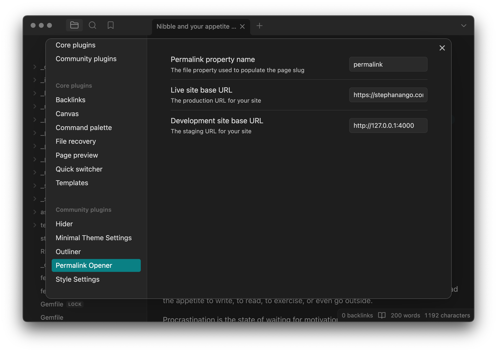

Simple Obsidian plugin that opens URLs based on a permalink or slug in the note properties. This is useful if you use a static site generator or publishing platform such as Jekyll, Hugo, Eleventy, Astro, Obsidian Publish, etc.

Very simple plugin with three settings:

- Permalink property name, defines the frontmatter property that you use. Defaults to `permalink` but you can set it to `slug` or something else.
- Live site base URL, e.g. `https://yourdomain.com`
- Development site base URL, for Jekyll you might use `http://127.0.0.1:4000`

Use the command palette or hotkeys to open the current page. The configured note property takes precedence. If it is missing, a leading HTML comment is checked (see below). If neither is set, the filename is lowercased and spaces are replaced with hyphens.



## Markdown without frontmatter

For publishing tools that do not accept YAML frontmatter, put a permalink comment at the start of the note:

```markdown
<!-- permalink: /manual -->

# Manual
```

Use the configured **Permalink property name** as the comment key (for example, `<!-- slug: /manual -->` when it is set to `slug`). The comment must be the first content in the file, apart from whitespace, and contain only the key and a single-line, unquoted path. Comments in the note body or code examples are ignored. Use `/` for the homepage.

This plugin opens existing pages; it does not publish or synchronize content, or read your site's routing configuration.

## Editable

[Editable](https://editable.website/) stores its editable pages in SQLite. To open one from a companion Obsidian note, set the note's permalink to the page's current URL path.

For [Editable's experimental Markdown pages](https://editable.website/manual#markdown-pages-experimental), YAML frontmatter is rejected but HTML comments are supported. Use the leading comment shown above, with a path that matches the `pathname` mapped to that file in `MARKDOWN_SOURCES` in your site's `src/app/content_config.ts`. For example, `<!-- permalink: /manual -->` opens the file mapped to `/manual`, even if the source file is named `README.md`.

Set the development base URL to your local Editable server (typically `http://localhost:5173`) and the live base URL to your deployed site. The comment does not configure an Editable route; keep it in sync with `MARKDOWN_SOURCES`.

## Zola

[Zola supports YAML as well as TOML frontmatter](https://www.getzola.org/documentation/content/page/). For use with Obsidian, use YAML frontmatter and set **Permalink property name** to `path`:

```yaml
---
title: My post
path: blog/my-post
---
```

With a live base URL of `https://example.com`, this opens `https://example.com/blog/my-post`. Zola's `path` overrides the filename, `slug`, and section path, making it useful for explicit URLs. Set the development base URL to your Zola server (typically `http://127.0.0.1:1111`).

You can also set the property name to `slug`, but Zola retains the section path when using `slug`: a post in `content/blog` with `slug: my-post` needs a base URL ending in `/blog` to open the correct URL. The plugin does not infer Zola's section paths, date-prefix removal, index-page routing, slugification options, or language prefixes, and Obsidian's metadata cache does not parse `+++` TOML frontmatter. Use an explicit YAML `path` for these cases.
